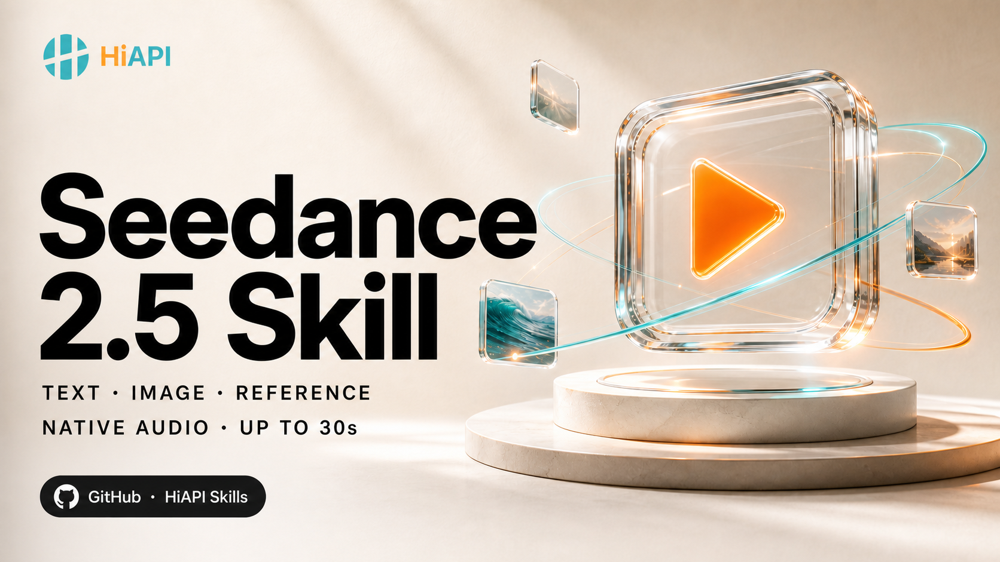

# HiAPI Seedance 2.5 Video Skill



An installable Agent Skill for planning, generating, recovering, downloading, and quality-checking Seedance 2.5 videos through HiAPI.

**Text-to-video · Image-to-video · Reference-to-video · Up to 30 seconds · Native audio**

[Get an API key](https://www.hiapi.ai/en/dashboard/api-keys) · [Pricing](https://www.hiapi.ai/en/pricing) · [API docs](https://docs.hiapi.ai/models/video/seedance-2-5/) · [Seedance 2.5 prompts](https://github.com/HiAPIAI/awesome-ai-video-prompts) · [All HiAPI Skills](https://github.com/HiAPIAI/hiapi-skills)

Languages: [English](README.md) | [简体中文](README.zh-CN.md)

## Why This Skill Exists

A useful video skill is more than a thin API call. This one separates creative planning from a paid side effect, chooses the correct production model ID, preserves recovery handles, and carries the result through technical and creative QC.

- Three production IDs: `seedance-2.5/text-to-video`, `image-to-video`, and `reference-to-video`.
- Live-aligned validation: 4-30 seconds, automatic -1 in reference mode, mode-specific 480p/720p/1080p, correct ratios and media limits.
- Cost-aware preflight: validate a redacted payload and fetch current public pricing before submitting.
- Duplicate-charge protection: idempotency keys and `--resume-task-id`.
- Long-job resilience: 120-minute default polling with transient retry.
- Required updates: new paid tasks require the latest verified skill; existing-task recovery remains available.
- Full workflow: brief, sources, prompt, estimate, generation, recovery, download, QC, edit, and publish gate.

## Install

Recommended:

```bash
npx -y github:HiAPIAI/hiapi-seedance-2-5-video-skill -y
```

Target one runtime:

```bash
npx -y github:HiAPIAI/hiapi-seedance-2-5-video-skill --codex
npx -y github:HiAPIAI/hiapi-seedance-2-5-video-skill --claude
npx -y github:HiAPIAI/hiapi-seedance-2-5-video-skill --target=/path/to/skills
```

OpenClaw:

```bash
openclaw skills add https://github.com/HiAPIAI/hiapi-seedance-2-5-video-skill
```

Restart the Agent after installation.

## Configure

```bash
export HIAPI_API_KEY="your_hiapi_api_key"
node scripts/check-config.mjs
```

Public three-model contract check (no paid task, does not validate the key):

```bash
node scripts/check-config.mjs --live
```

## Safe First Run

Validate the request and fetch a current estimate without creating a paid task:

```bash
node scripts/hiapi-seedance-2-video.mjs \
  --prompt "A continuous cinematic shot of a glass pavilion above a stormy ocean" \
  --seconds 5 \
  --resolution 720p \
  --ratio 16:9 \
  --dry-run \
  --estimate
```

After reviewing it, remove `--dry-run --estimate` to submit.

## Examples

Text-to-video:

```bash
node scripts/hiapi-seedance-2-video.mjs \
  --prompt "A continuous cinematic shot of a glass pavilion above a stormy ocean" \
  --seconds 5 \
  --resolution 1080p \
  --ratio 16:9 \
  --generate-audio
```

First/last-frame image-to-video:

```bash
node scripts/hiapi-seedance-2-video.mjs \
  --prompt "Move naturally from the opening frame to the final hero composition" \
  --first-frame-url "https://example.com/first.png" \
  --last-frame-url "https://example.com/last.png" \
  --seconds 8 \
  --resolution 720p
```

Reference-to-video:

```bash
node scripts/hiapi-seedance-2-video.mjs \
  --prompt "Use @video1 camera motion, @image1 subject design, and @audio1 voice" \
  --reference-video-url "https://example.com/motion.mp4" \
  --reference-video-duration 12 \
  --reference-image-url "https://example.com/subject.png" \
  --reference-audio-url "https://example.com/voice.wav" \
  --reference-audio-duration 12 \
  --seconds 12 \
  --resolution 720p
```

Recover a task without creating or billing a duplicate:

```bash
node scripts/hiapi-seedance-2-video.mjs --resume-task-id "tk-hiapi-..."
```

## Current Contract

| Capability | Current HiAPI support |
| --- | --- |
| Duration | Integer 4-30 seconds; reference mode also accepts -1 for automatic output |
| Text/image resolution | 720p, 1080p; default 720p |
| Reference resolution | 480p, 720p, 1080p; default 480p |
| Output | MP4, MOV |
| Text/reference ratios | 16:9, 4:3, 1:1, 3:4, 9:16, 21:9, adaptive |
| Image mode ratio | adaptive; follows first frame |
| Reference images | Up to 30 |
| Reference videos | Up to 10; each 2-30s; total ≤30s |
| Reference audio | Up to 10; each 2-30s; total ≤30s |

The skill validates resolution after selecting the mode: text/image requests cannot send `480p`, while reference mode retains it. The current public contract does not expose 4K. Run the live check before changing these limits.

## Required Update to 1.2.0

Older releases reject automatic reference duration and underestimate reference-video charges. Re-run the installer before creating another paid task. R2V bills reference plus output duration; automatic estimates are ranges. See the [complete parameter map](references/api.md).

The runtime reads the central [HiAPI Skills](https://github.com/HiAPIAI/hiapi-skills) manifest and falls back to this repository's [`update-policy.json`](update-policy.json).

- A newer published version must be installed before creating another paid task.
- The 1.2.0 minimum fixes incompatible duration validation and reference-video billing estimates.
- Existing-task recovery stays available during a hard upgrade.
- From 1.2.0, offline or disabled checks allow preflight and recovery only, not new paid creation. This is a client-side gate, not an API access restriction.

See [references/upgrade-policy.md](references/upgrade-policy.md).

## Production Workflow

The reusable workflow is documented in [references/workflow.md](references/workflow.md):

`outcome → source/rights audit → mode → timed plan → prompt → dry-run/estimate → submit once → recover/download → technical QC → creative QC → edit → publish gate`

Generation is not publication. The skill never publishes a result or claims a public post without explicit authorization and a verified public URL.

## Development

```bash
npm test
npm run check:contract
```

The contract check reads public schemas and pricing metadata only. It does not create a task, validate the API key/account balance, or prove provider capacity.

GitHub Actions runs the unit suite on every change and checks the three public model schemas daily so contract drift is visible before an upgrade policy is changed.

## License

MIT
